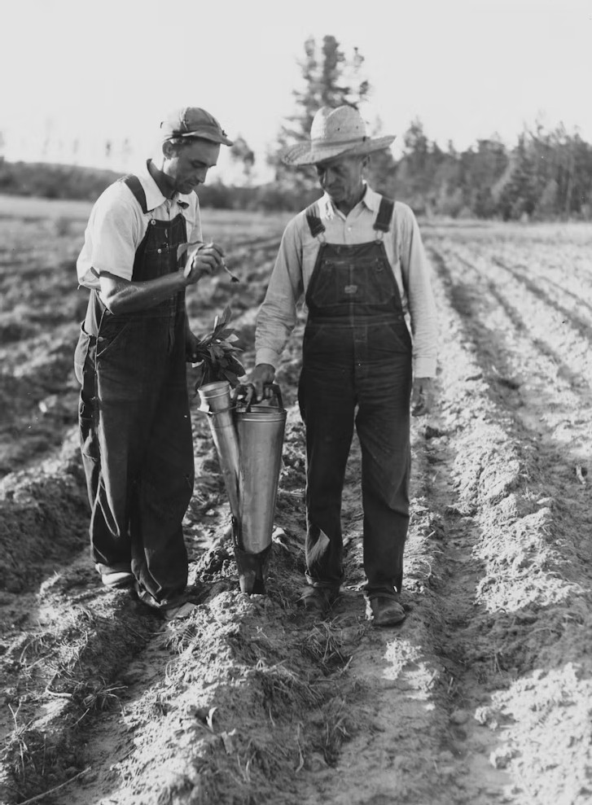
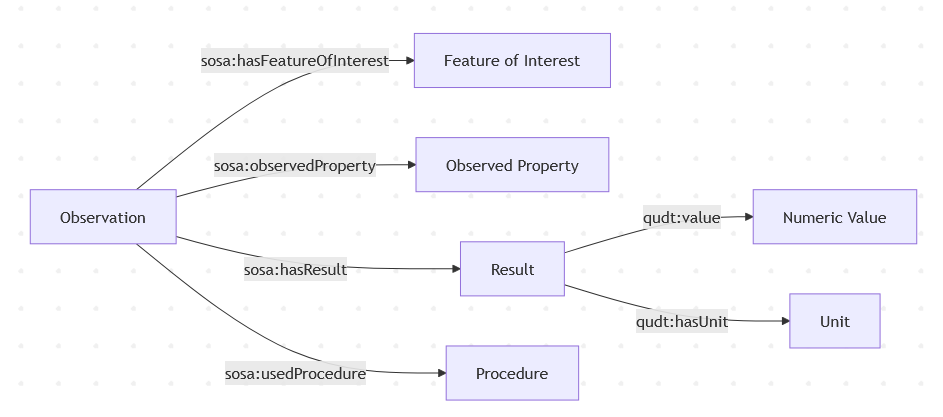
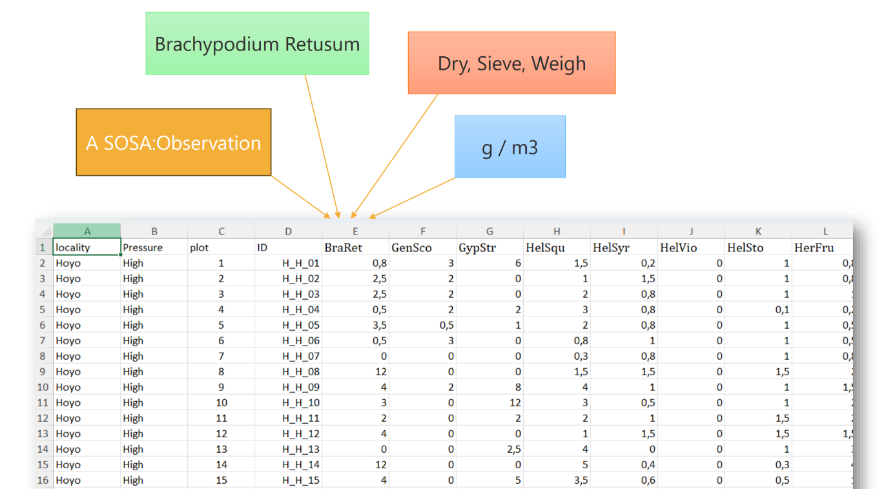

## Contents

- Mission Soil & SOILWISE 
- Interoperable soil data sharing
- Bit of History
- Where we got stuck
- How we (likely) proceed
- Suggestions from the audience

## Mission Soil

- Protect and restore soil health across Europe by 2030 (2021–2027)
- Connects research, innovation and practice to accelerate the transition towards healthy soils
- Budget: €542 million in Horizon Europe funding committed to 75 Mission Soil projects

## SoilWise 

- Strengthen the Mission Soil knowledge base by making soil research, data and solutions easier to find, access, combine and reuse
- Budget and duration: €6 million EU contribution under Horizon Europe; runs from September 2023 to August 2027. 
- Wageningen University, WENR and ISRIC are 3 out of 14 partners (coordination at ILVO Flanders)

## Interoperable soil data sharing

- Institutes and memberstates have tailored practices, goals and legislation to collect and store soil observation data 
- Bringing the data together to have a pan-european view on soil health is a challenge
- FAIR principles have increased findability considerably, let's move to interoperability 

## Bit of History

## Global Soil Map and SOTER

Various efforts in the community to set up a standardised data model for soil data:

- [Global Soil Map](https://isric.org/projects/globalsoilmapnet)
- [SOil and TERrain database](https://isric.org/explore/soter)

These initiatives are still relevant today

## INSPIRE regulation and ISO standards

- The ISO28258 standard and INSPIRE community developed their standard for soil data synchronously around 2010.
- Both standards are based on the OGC Observations & Measurements standard
- SSN/SOSA is a semantic implementation of OMS

## SOSA

## FAIR practices

- Use of repositories and registration of DOI's
- [RO-Crate](https://www.researchobject.org/ro-crate/) describes date files within a repository deposit, in combination with schema.org and/or [frictionless datapackage](https://datapackage.org/)
- Investigation, Study, Assay ([ISA](https://isa-specs.readthedocs.io/)) describes the context of an experiment
- [i-Adopt](https://i-adopt.github.io/) unpacks (soil) properties, into its components 

## Observation standards in other communities

- Nature observations ([GBIF EML](https://github.com/gbif/eml-profile))
- Plant Phenotyping Experiments ([MIAPPE](https://www.miappe.org))
- Statistics ([DDI-CDI](https://ddialliance.org/ddi-cdi))
- Geology [GeoSciML](https://geosciml.org)

## Our ambitions

- A metadata approach oriented around tabular data
- Easy and flexible
- Using, or based on existing standards

## The data dictionary

- Data dictionaries that describe a dataset are quite common
- Not many initiatives exist to standardise these data dictionaries

Samples

- [data.gouv.fr](https://recherche.data.gouv.fr/en/category/33/guide/readme-template)
- [UKDataService](https://ukdataservice.ac.uk/help/deposit-data/prepare-your-data-for-deposit/)
- [osf.io](https://help.osf.io/article/217-how-to-make-a-data-dictionary)
- [FAIR2](https://fair-squared.github.io/fair2-spec/v1.3.0/specification/data-dictionary)

## A sample

## Our approach

Test various approaches on 10 tabular sample datasets, going from CSV to RDF and back from RDF to Tabular: 

- CSV on the Web
- R2RML
- ISA-tab
- INSPIRE GeoPackage / Hale Studio

## Where we got stuck

- CSV-W is a good fit for literature reviews and vocabularies
- RML is powerfull for software developers
- ISA-tab & INSPIRE GeoPackage interesting for certain use cases

## How we (likely) proceed

- Define a new microformat for Observation Data; OMS-tab
- [Webbased tool](https://dataannotator-swc.streamlit.app/Input) to create OMS-tab from CSV
- Software package to transform OMS-tab to RML
- [API](https://api.soilwise-he.eu/csvw/docs) to transform csv+rml to RDF
- RDF to CSV utility for SSN-SOSA 

## Suggestions from the audience

...
